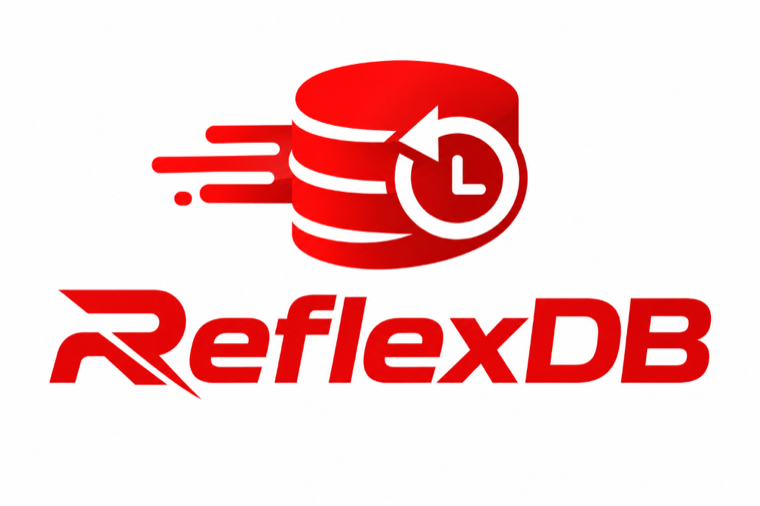

<div align="center">



### _The state store that lets you **watch** it change and **rewind** it._

A **RESP-compatible**, **Rust-native** data store with three things Redis doesn't have:
**live query push**, **per-key time travel**, and **RAM→disk tiering**.

[](LICENSE)
[](https://www.rust-lang.org)
[](docs/RFX.md)
[](docs/BENCHMARKS.md)

**`SET` it. `LIVE` it. `GETAT` yesterday.**

</div>

---

## 🔥 Why ReflexDB

Your background job wrote a **wrong value at 3am**. With any other fast store, that state is
*gone*. With ReflexDB:

```text
> HISTORY job:123        ← every version the key ever had
> GETAT job:123 <ts>     ← the value *before* the bad deploy
> LIVE GET job:status    ← pushed the new result on every write, no polling
```

- 🔴 **`LIVE` / `UNLIVE`** — subscribe to a *query's result*, get pushed every change.
  A dedicated fan-out thread + configurable sweep/pace windows keep 5,000 watchers at
  **~3.3k writes/s, p50 ≈ 150µs** — without taxing connections that subscribe to nothing.
- ⏪ **`GETAT` / `HISTORY`** — per-key version history, disk-backed, TTL'd, capped.
  *"What did this key look like before the incident?"* is now a one-word answer.
- 💾 **Tiered storage** — cold keys spill to a `fjall` LSM disk tier and promote back on
  read. Working set **>** RAM budget. Full tier? Your call: `reject-writes`,
  `evict-oldest`, or `no-limit`.
- 🛡️ **Hardened** — real ACL enforcement (`+@categories`, `%R~`/`%W~` key scopes),
  `protected-mode` default-on, AUTH brute-force cap, `port 0` TLS-only mode, `MISCONF`
  on AOF failure, `SHUTDOWN` + signal-graceful exit.
- 🔄 **Durable your way** — `profile cache | durable | replicated` presets,
  `min-replicas-to-write`, `WAIT`/`WAITAOF` ack points, compressed RDB + AOF.
- 🔌 **Drop-in RESP** — point `redis-cli` at it. Optional **RFX** binary wire format
  auto-detected per connection for clients that want less parsing.

---

## 🚀 Try it in 5 minutes

No experience needed — three steps.

**1️⃣ Install Rust** (skip if you already have it):

```sh
curl --proto '=https' --tlsv1.2 -sSf https://sh.rustup.rs | sh
```

**2️⃣ Build & run:**

```sh
git clone https://github.com/kailash-kangne/reflexdb.git && cd reflexdb
cargo build --release
./target/release/reflexdb-server reflexdb.conf
```

You should see `reflexdb-server listening addr=127.0.0.1:7379`. That's it — the database is up.
Prefer Docker? `docker build -t reflexdb . && docker run -p 7379:6379 reflexdb`.

**3️⃣ Talk to it.** You already have a client: `redis-cli` ships with Redis and with
`brew install redis` on macOS — and ReflexDB speaks the same protocol:

```sh
redis-cli -p 7379 set foo bar     # OK
redis-cli -p 7379 get foo         # "bar"
```

Or use the built-in CLI: `cargo run --release --bin reflexdb-cli -- -p 7379`

---

## 🎮 The fun part — 3 things to try right now

### 🔴 1. Watch a key change *live* (no polling)

Open **two terminals**, run `redis-cli -p 7379` in each:

```text
Terminal 1                          Terminal 2
> LIVE GET foo
1) "live"  2) "fingerprint"
3) "<crc64>"  4) "result"
5) "bar"

                                    > SET foo changed!
  ← pushed automatically: 5) "changed!"
```

Every write anywhere instantly pushes the new result to every watcher. `UNLIVE` to stop.

### ⏪ 2. Travel back in time

History is on by default (`history-enabled yes` in `reflexdb.conf` — set `no` to save the
per-write disk I/O). With it running:

```text
> SET job:status running
> SET job:status crashed
> HISTORY job:status          ← every version + when it was written
> GETAT job:status <earlier>  ← the value *before* the crash
```

### 💾 3. Store more than your RAM

```text
# in reflexdb.conf:
tiered-storage yes
tiered-memory-limit 250mb     # hot keys stay in RAM
tiered-disk-limit 2gb         # cold keys spill to disk — reads bring them back
```

RAM fills? Oldest keys move to disk *instead of being dropped*. Disk full too? The
`tiered-overflow-policy` decides: `reject-writes` (safe, nothing lost),
`evict-oldest` (cache semantics), or `no-limit`.

### 🧪 …or just click around in the browser

**reflexdb-bench-ui** — the web UI for *everything*: benchmarks, demos, and Studio:

```sh
cargo build --release --bin reflexdb-server --bin reflexdb-bench-ui
./target/release/reflexdb-server reflexdb.conf &
BENCH_UI_BIND=127.0.0.1:8080 ./target/release/reflexdb-bench-ui
```

Open `http://127.0.0.1:8080` — run workloads, watch latency charts, fire the
**LIVE fan-out demo**, fill the disk tier in the **tiered overflow demo**, and
pit Redis vs Dragonfly vs ReflexDB in the **Engine Shootout** tab. Then flip to
the **Studio** tab to inspect the data those runs just wrote: **key browser**
with pattern search, **value inspector** (strings, hashes, lists, sets, zsets,
streams), **history timeline** with two-version diff + JSON/CSV export,
**LIVE query viewer**, **health dashboard** (memory, disk, replication, AOF),
and the **slowlog**. No commands to memorize.

**Public sandbox mode** — let visitors try ReflexDB without touching your server. A
warm pool of throwaway `reflexdb-server` instances is checked out one per browser
session, wiped (`FLUSHALL`) and recycled on release or idle expiry; every session
is logged to sqlite. Disabled by default — enable with env vars:

```sh
BENCH_UI_BIND=0.0.0.0:8080 \
BENCH_UI_POOL_SIZE=10 \          # sandboxes kept warm (max concurrent visitors)
BENCH_UI_PORT_BASE=21100 \       # sandbox instances listen on 21100+
BENCH_UI_SESSION_IDLE_SECS=300 \ # idle sessions expire and recycle
BENCH_UI_SESSION_DB=/var/lib/reflexdb/sessions.db \
./target/release/reflexdb-bench-ui
```

In public mode `/run-*` benchmark endpoints are blocked and `/api/*` needs a
session cookie (`POST /api/session` issues one; the Studio page does this
automatically). Put it behind TLS (Caddy/nginx) and add a per-IP rate limit
before exposing it — each pool slot is real RAM.

---

## 📊 Benchmarks — measured, not claimed

Redis 7 · Dragonfly · ReflexDB — same Docker caps (2 GiB, `--cpus`), same clients,
same workloads, median of 3. On a loaded host:

| | Pipeline 1 | Pipeline 16 |
|---|--:|--:|
| small-mixed, 1 CPU | **ReflexDB — 17,249** ops/s | **ReflexDB — 149,301** ops/s |
| hot-key, 4 CPUs | **ReflexDB — 16,866** ops/s | **ReflexDB — 163,143** ops/s |

**ReflexDB led all eight shootout cells** — plus all five aggressive cases
(64 clients, deep P64 pipelines, 100k keys, 8 KiB values). All engines within ~±15%;
*one machine, one session — re-measure before quoting.*
Full tables: [docs/BENCHMARKS.md](docs/BENCHMARKS.md).

---

## 🧰 The fleet

| Binary | What it does |
|--------|--------------|
| 🗄️ `reflexdb-server` | **The database itself.** |
| 🔀 `reflexdb-proxy` | Zero-parsing pass-through relay in front of an *existing* RESP server — try ReflexDB without migrating a byte. |
| 🚨 `reflexdb-sentinel` | Automatic failover watcher for primary/replica groups. |
| 💻 `reflexdb-cli` | Interactive CLI client. |
| 📈 `reflexdb-bench-ui` | Local web UI — workloads, latency charts, LIVE/tiered demos, engine shootout, **plus Studio** (key browser, value inspector, history timeline + diff/export, LIVE viewer, health, slowlog). |

---

## 📚 Docs

| File | Contents |
|------|----------|
| [docs/FEATURES.md](docs/FEATURES.md) | Everything shipped: types, persistence, security, LIVE, time travel, tiering |
| [docs/COMMANDS.md](docs/COMMANDS.md) | Full command reference — implemented vs. planned, honestly labeled |
| [docs/ARCHITECTURE.md](docs/ARCHITECTURE.md) | Crate layout, concurrency model, commit order, internals |
| [docs/SECURITY.md](docs/SECURITY.md) | Threat model, ACL semantics, known gaps — *read this before prod* |
| [docs/BENCHMARKS.md](docs/BENCHMARKS.md) | Numbers above, reproduced |
| [docs/OPERATIONS.md](docs/OPERATIONS.md) | Running it for real — durability, backups, replication, failover, monitoring |
| [docs/TIERED.md](docs/TIERED.md) | RAM→disk tiering and the overflow policies |
| [docs/RFX.md](docs/RFX.md) | The binary wire format |
| [docs/ROADMAP.md](docs/ROADMAP.md) | Product and engineering sequence |
| [docs/PRODUCT_DIRECTION.md](docs/PRODUCT_DIRECTION.md) | The hypothesis, validation plan, what we're *not* building |

---

## 🧭 Honest status

- This is a **prototype with a hypothesis**: long-running workflows (agents, pipelines, job
  queues) need a fast store that can *also* answer _"what changed and how do I recover"_ —
  without bolting on separate logging/snapshot/event-sourcing infra. Not yet a validated
  product; see [docs/PRODUCT_DIRECTION.md](docs/PRODUCT_DIRECTION.md).
- Command coverage is a **subset** of Redis — check [docs/COMMANDS.md](docs/COMMANDS.md)
  before pointing an app at it.
- Memory-first store. Durability is configurable (`profile durable`), but this is not a
  system of record.
- Everything here is **original Rust** — no borrowed Redis code.

## 📜 License

**Business Source License 1.1** — free for essentially everything, including production
use, *except* offering ReflexDB to third parties as a hosted/managed service. Converts to
**Apache-2.0** four years after each release. See [LICENSE](LICENSE).
